<p align="center">
  
</p>

<p align="center">
  Script to prevent dependencies from executing <b>preinstall</b> and <b>postinstall</b> scripts when installed directly from Git. Keep your root developer tooling while protecting consumer projects.
</p>

<p align="center">
  <a href="LICENSE"></a>
  <a href="https://www.npmjs.com/package/ignore-dependency-scripts"></a>
  <a href="https://www.npmjs.com/package/ignore-dependency-scripts"></a>
  
  <a href="https://github.com/douglasjunior/ignore-dependency-scripts/pulls"></a>
</p>

<p align="center">
  <a href="#-quick-start"><b>Quick Start</b></a> ·
  <a href="#-why-ignore-dependency-scripts">Why</a> ·
  <a href="#-how-it-works">How It Works</a> ·
  <a href="#-common-use-cases">Use Cases</a> ·
  <a href="#-comparison-with-alternatives">Alternatives</a> ·
  <a href="#-contributing">Contributing</a> ·
  <a href="#-license">License</a>
</p>

---

## 🚀 Quick Start

Replace your direct lifecycle script in `package.json`:

```diff
  // package.json
  {
    "name": "my-library",
    "scripts": {
-     "postinstall": "husky install"
+     "postinstall": "npx --yes ignore-dependency-scripts \"husky install\""
    }
  }
```

> Replace `"husky install"` with any command you need, such as `npx pod-install` or multi-command chains (`"husky install && npx pod-install"`).

### How it behaves

- **When developing locally** (`npm install` or `yarn install` inside `./my-library`): the script runs normally.
- **When installed as an npm Git dependency** (`npm install git+https://...` in another project): a wrapped `postinstall` runs after npm packs the checkout, when `.git` is absent, so the command is skipped. `prepare` is an exception: npm runs it in the cloned checkout before packing, while `.git` is still present, so this wrapper executes the command.

### Why not install it as a devDependency?

Use `npx --yes ignore-dependency-scripts "..."` as shown above when wrapping a lifecycle script that runs after a Git checkout has been packed, such as `postinstall`. This will not skip a Git dependency's `prepare`: npm runs `prepare` in the cloned checkout before packing, with `.git` present, and this wrapper will execute the command.

The packed Git dependency's `devDependencies` are not installed into the consumer's project. However, [npm's lifecycle documentation](https://docs.npmjs.com/cli/v8/using-npm/scripts#life-cycle-scripts) states that when a Git-installed package defines `prepare`, npm installs the checkout's `dependencies` and `devDependencies`, runs `prepare`, and only then packs and installs the package. At this stage the checkout still contains `.git`, so this wrapper executes the command. If you reference the binary directly in a lifecycle script that runs after packing, declare `ignore-dependency-scripts` under `dependencies` instead:

```bash
npm install --save ignore-dependency-scripts
# or
yarn add ignore-dependency-scripts
```

Then reference the binary directly:

```json
{
  "scripts": {
    "postinstall": "ignore-dependency-scripts \"husky install\""
  }
}
```

## 💡 Why ignore-dependency-scripts?

- 🛡️ **Skip wrapped scripts after packing.** The wrapper checks for `.git` in `process.cwd()`, so it can skip a wrapped script such as `postinstall` when a Git dependency has been packed and installed. npm's Git-dependency `prepare` is an exception: it runs in the checkout before packing, while `.git` is still present, so the wrapped command executes.
- ⚡ **Zero runtime dependencies.** Written in lightweight pure Node.js using only standard library modules (`fs`, `path`, `child_process`). Adds zero bloat to your dependency tree.
- 📦 **No private npm registry required.** Share libraries directly via Git URLs (`git+ssh://` or `git+https://`) without managing an expensive or complex private npm registry.
- 🔧 **Seamless Git submodule workflows.** The script checks for `.git` in `process.cwd()`. Lifecycle scripts run from a monorepo subfolder such as `packages/*` will be skipped because that directory does not contain the repository's `.git` path.
- 🌐 **Documented package manager workflows.** The examples cover npm and Yarn; compatibility with other package managers and platforms has not been verified.

## 🧠 How It Works

When `ignore-dependency-scripts` executes, it checks whether a `.git` folder exists in the current working root directory (`process.cwd()`):

| Environment | `.git` Folder | Status | Behavior |
|---|---|---|---|
| **Local Development**<br>`./my-library` | **Present** | **Executed** | Spawns the specified command with `child_process.exec()`, pipes both child `stdout` and `stderr` to `process.stdout`, then exits with the child's exit code after logging `Process exited with code: N`. |
| **Packed Dependency Lifecycle**<br>`./consumer-app/node_modules/my-library` | **Absent** | **Ignored** | For lifecycle scripts that run after packing, prints `Ignored script: <command>` and exits cleanly (`code: 0`) without executing the command. npm's Git-dependency `prepare` runs earlier, in the checkout with `.git` present. |

```text
                                 ┌─────────────────────────┐
                                 │   Does .git folder exist│
                                 │      in process.cwd()?  │
                                 └───────────┬─────────────┘
                                             │
                       ┌─────────────────────┴─────────────────────┐
                       ▼                                           ▼
                     Yes                                          No
         [Local Repository Dev]                         [Packed Dependency Lifecycle]
                   │                                               │
                   ▼                                               ▼
     Execute specified script                         Log "Ignored script" & exit 0
  (e.g., husky install, pod-install)                    (e.g., postinstall)
```

<details>
<summary><b>Stack Overflow references and background</b></summary>

This utility solves the long-standing limitation where package managers do not differentiate between root development and Git dependency installations:

- [Stack Overflow: Prevent git dependency postinstall script](https://stackoverflow.com/q/72092997/2826279)
- [Stack Overflow: npm install from git repo without postinstall](https://stackoverflow.com/q/54212147/2826279)
- [Stack Overflow: Ignore npm postinstall when installed as dependency](https://stackoverflow.com/q/23505318/2826279)
- [Stack Overflow: Prevent running scripts on git install](https://stackoverflow.com/q/44749524/2826279)
- [Stack Overflow: Yarn postinstall script only for root](https://stackoverflow.com/q/41015620/2826279)
- [Stack Overflow: Inspired by directory detection strategy](https://stackoverflow.com/a/68915638/2826279)

</details>

## 🔧 Common Use Cases

### 1. Husky Git Hooks

Run Husky in local development, but skip it when the packed Git dependency is installed by a consumer:

```json
{
  "scripts": {
    "postinstall": "npx --yes ignore-dependency-scripts \"husky install\""
  }
}
```

Do not use this wrapper to suppress `prepare` for a Git dependency: npm runs that script in the cloned checkout before packing, while `.git` is present.

### 2. React Native CocoaPods Installation

Avoid running `pod-install` on platforms or host projects where iOS dependencies are unnecessary:

```json
{
  "scripts": {
    "postinstall": "npx --yes ignore-dependency-scripts \"npx pod-install\""
  }
}
```

### 3. Combining Multiple Commands

Chain any shell commands within the quoted argument:

```json
{
  "scripts": {
    "postinstall": "npx --yes ignore-dependency-scripts \"husky install && npm run build:local\""
  }
}
```

## 🔄 Comparison with Alternatives

| Feature / Solution | `ignore-dependency-scripts` | `typicode/pinst` | `bahmutov/am-i-a-dependency` |
|---|---|---|---|
| **Direct Git Dependencies** | ✅ **Wrapped scripts after packing** | ❌ Requires npm publish hooks | ⚠️ Requires code integration |
| **Zero Configuration** | ✅ Wrap command in CLI | ⚠️ Needs prepublish/postpublish hooks | ❌ Needs custom JS wrapper |
| **Dependencies** | ✅ **0 dependencies** | ❌ External packages | ❌ External package |
| **Package Manager Compatibility** | ✅ npm and Yarn documented | ⚠️ npm/yarn publish focused | ⚠️ npm/yarn |

## 🤝 Contributing

Contributions, bug fixes, and feature suggestions are welcome!

1. Fork the repository and create your topic branch (`git checkout -b feat/my-improvement`).
2. Make your changes and test them locally.
3. Commit your changes following [Conventional Commits](https://www.conventionalcommits.org/).
4. Push to your branch and open a Pull Request.

For bugs and feature requests, please [open an issue](https://github.com/douglasjunior/ignore-dependency-scripts/issues).

## 💖 Support

If this project is useful to you, you can support its development on [Patreon](https://www.patreon.com/douglasjunior), via [PayPal](https://paypal.me/douglasnassif), or through [GitHub Sponsors](https://github.com/sponsors/douglasjunior).

## ⭐ Star History

If `ignore-dependency-scripts` solved your Git dependency lifecycle issues, consider giving it a star on GitHub.

<a href="https://star-history.com/#douglasjunior/ignore-dependency-scripts&Date">
  <picture>
    <source media="(prefers-color-scheme: dark)" srcset="https://api.star-history.com/svg?repos=douglasjunior/ignore-dependency-scripts&type=Date&theme=dark">
    
  </picture>
</a>

## 📄 License

[MIT](LICENSE) © [Douglas Nassif Roma Junior](https://github.com/douglasjunior)

<p align="center">
  <a href="https://douglasjunior.work">
    
  </a>
</p>
